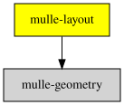

# 📏 mulle-layout

#### 📏 Rectangle geometry and manual layouting


This library contains functions for manual layouting of rectangles.

| Datatype             | Description                                                      |
|----------------------|------------------------------------------------------------------|
| `CGRectEdge`         | legacy compatibility enum for CADirection                        |
| `CGContentMode`      | an enumeration of various placements like `CGContentModeTopLeft` |
| `struct MulleLayout` | layout rectangles in row column fashion                          |
| `struct MulleGrid`   | layout rectangles in a uniform grid                              |


Here you can see a demo of the library in action. The available window space
is split into vertical and horizontal slices using "paritioning".

In the first row you see "contentmode" examples of a rectangle inside
another rectangle.

In the second and third row, you see "placement" of a rectangle with fixed
size relative to another rectangle of fixed size.

The fourth row, shows "placement" of a rectangle of "flexible" size
relative to another rectangle of fixes size.

The last row, shows the "layout" code, placing rectangles in column first,
then row fashion.


### You are here




## Attribution

The library contains the `CGRectDivide` function:

```
Copyright (c) 2006-2007 Christopher J. W. Lloyd
Copyright (c) Microsoft. All rights reserved.
```